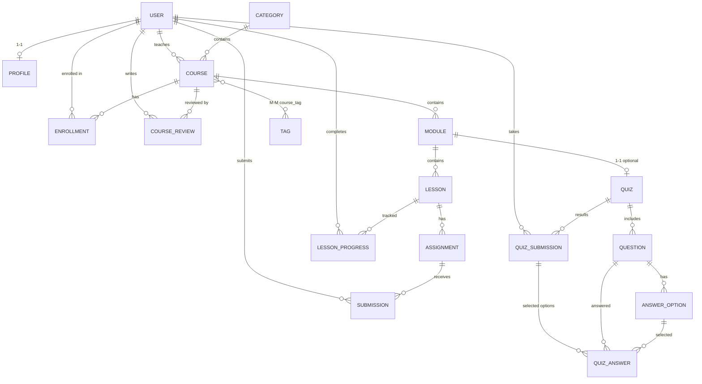

# Study Platform

Серверное приложение на **Spring Boot 3 + Spring Data JPA/Hibernate + PostgreSQL** для управления онлайн-курсами:
каталог курсов со структурой «курс - модули - уроки», запись студентов, задания и их проверка, тесты с автоматической
оценкой, отзывы и прогресс. Проект сознательно построен на ленивой загрузке (`LAZY`).

## Содержание

1. [Стек](#стек)
2. [Быстрый старт](#быстрый-старт)
3. [Конфигурация и профили](#конфигурация-и-профили)
4. [Модель данных](#модель-данных)
5. [Ленивая загрузка на практике](#ленивая-загрузка-на-практике)
6. [REST API](#rest-api)
7. [Архитектура](#архитектура)
8. [Тестирование](#тестирование)
9. [Docker и CI](#docker-и-ci)

## Стек

Java 17+ (компиляция с `release 17`, проверено на JDK 25), Spring Boot 3.5, Spring Data JPA (Hibernate 6.6), Bean
Validation, PostgreSQL 14+,
Maven, Lombok (`@Getter/@Setter`, логгер), springdoc-openapi (Swagger UI), JUnit 5 / Mockito / AssertJ / MockMvc, H2 (
тесты).

## Быстрый старт

### Вариант 1. Локально (Maven + PostgreSQL)

Установите JDK 17+, Maven и PostgreSQL, запустите службу PostgreSQL. Java, Maven и `psql` должны быть доступны в `PATH`.
Команды выполняйте из корня проекта. Maven автоматически загрузит библиотеки, указанные в `pom.xml`.

1. Создайте базу данных (один раз):
   ```bash
   psql -h localhost -U postgres -d postgres -W -c "CREATE DATABASE study_platform"
   ```
2. Задайте параметры подключения переменными окружения (значения по умолчанию: `localhost:5432/study_platform`,
   пользователь `postgres`, пароль — **обязательно свой**):
   ```bash
   export DB_PASSWORD='ваш_пароль'
   ```

   Для PowerShell вместо `export`:

   ```powershell
   $env:DB_PASSWORD = "ваш_пароль"
   ```

   При другом имени БД или пользователе задайте также `DB_URL` и `DB_USERNAME` (см. таблицу конфигурации).
   Запускайте приложение в том же окне терминала, где заданы переменные.
3. Запустите:
   ```bash
   mvn spring-boot:run
   ```
   Схема БД создаётся автоматически (`ddl-auto=update`). В профиле `dev` (по умолчанию) загружаются
   демо-данные, если таблица пользователей пуста. Для остановки нажмите `Ctrl+C`.

Адрес сервера — `http://localhost:8080`. Для ручной работы используйте
Swagger UI: <http://localhost:8080/swagger-ui/index.html> ·
Health: <http://localhost:8080/actuator/health>

### Вариант 2. Docker Compose (приложение + PostgreSQL)

Нужны Docker и Docker Compose. Скопируйте `.env.example` в `.env` и задайте свой `DB_PASSWORD`:

```bash
cp .env.example .env
```

В PowerShell используйте `Copy-Item .env.example .env`. После редактирования файла запустите:

```bash
docker compose up --build
```

Compose запускает отдельную PostgreSQL и приложение на порту 8080. Локальный экземпляр приложения
на этом порту должен быть остановлен. Для остановки контейнеров используйте `docker compose down`;
данные сохраняются в томе `pgdata`.

Файл `.env` читает Docker Compose. При локальном запуске через Maven он автоматически не загружается —
задайте переменные в терминале, как показано выше. Не добавляйте `.env` с паролем в репозиторий.

### Демо-данные

В `dev`, если таблица пользователей пуста, создаются (через сервисный слой): преподаватель `teacher@study.local`,
студенты
`alice@study.local` и `bob@study.local`, администратор, 2 категории, 3 тега, курс «Основы Hibernate»
(2 модуля, 4 урока), второй курс, задание, запись студентов, оценённое решение, тест с результатом и отзыв.
Если в таблице пользователей есть хотя бы одна запись, всё демо-наполнение пропускается.
Для локального запуска его можно отключить переменной `SEED_DEMO_DATA=false`.
В Compose демо-наполнение включено явно в `docker-compose.yml`.

Пример сценария:

```bash
curl localhost:8080/api/courses                        # каталог
curl localhost:8080/api/courses/1                      # курс со структурой (модули и уроки)
curl localhost:8080/api/users/2/assignments            # решения студента с оценками
curl localhost:8080/api/users/2/quiz-results           # результаты тестов
curl -X POST "localhost:8080/api/courses/2/enroll?user=3"   # записать студента на курс
```

ID в примерах условные: сначала получите курсы через `GET /api/courses`, пользователей — через
`GET /api/users`, затем подставьте их ID. Студент должен быть записан на нужный курс перед сдачей работы или теста.
В Windows PowerShell используйте `curl.exe` вместо `curl`, чтобы вызвать именно утилиту curl.

## Конфигурация и профили

Все параметры берутся из `application*.yml` и переменных окружения.

| Переменная       | По умолчанию                                      | Назначение                      |
|------------------|---------------------------------------------------|---------------------------------|
| `DB_URL`         | `jdbc:postgresql://localhost:5432/study_platform` | JDBC URL                        |
| `DB_USERNAME`    | `postgres`                                        | пользователь БД                 |
| `DB_PASSWORD`    | *(пусто)*                                         | пароль БД                       |
| `DDL_AUTO`       | `update` (`dev`), `validate` (`prod`)             | `spring.jpa.hibernate.ddl-auto` |
| `SEED_DEMO_DATA` | `true` в `dev`, иначе `false`                     | загрузка демо-данных            |
| `SERVER_PORT`    | `8080`                                            | порт приложения                 |

Профили (`SPRING_PROFILES_ACTIVE`):

* `dev` (по умолчанию) — SQL/DEBUG-логи, демо-данные;
* `prod` — `ddl-auto=validate` (схема не меняется автоматически), без демо-данных;
* `test` — H2 в режиме PostgreSQL, используется автотестами.

В `prod` схема должна существовать заранее: `validate` только проверяет её соответствие моделям.

`spring.jpa.open-in-view=false` — **намеренно**: после закрытия сессии нельзя загрузить
неинициализированные ленивые связи. Уже загруженные данные остаются доступны.

## Модель данных

17 сущностей; связи 1-1, 1-M и M-M. Все связи `@ManyToOne`/`@OneToOne`/коллекции объявлены с `fetch = LAZY`.



| Сущность                           | Назначение / особенности                                                                   |
|------------------------------------|--------------------------------------------------------------------------------------------|
| `User`                             | роль `STUDENT/TEACHER/ADMIN`, уникальный `email`; профиль 1-1                              |
| `Profile`                          | редко используемые поля пользователя (владелец FK, `unique`)                               |
| `Category`, `Tag`                  | справочники; `Course ↔ Tag` — M-M через `@JoinTable course_tag` без сущности-связки        |
| `Course`                           | категория и преподаватель (`@ManyToOne`), модули (cascade `ALL` + `orphanRemoval`)         |
| `Enrollment`                       | M-M «студент ↔ курс» с данными (`enrollDate`, `status`), `unique(user, course)`            |
| `Module`, `Lesson`                 | структура курса; `orderIndex`, сортировка `@OrderBy`                                       |
| `LessonProgress`                   | отметка о прохождении урока, `unique(student, lesson)`                                     |
| `Assignment`, `Submission`         | задание и решение (`score`, `feedback`, `status`), `unique(student, assignment)`           |
| `Quiz`, `Question`, `AnswerOption` | тест модуля (1-1), вопросы (`SINGLE_CHOICE` / `MULTIPLE_CHOICE`), варианты ответа          |
| `QuizSubmission`, `QuizAnswer`     | результат прохождения; каждый `QuizAnswer` связывает результат, вопрос и выбранный вариант |
| `CourseReview`                     | отзыв (1–5), `unique(student, course)`                                                     |

### Правила удаления

* **Курс**: нельзя удалить при активных записях студентов (`409`); иначе каскадно удаляются модули, уроки, задания,
  решения, тесты, результаты, записи, отзывы. **Теги не удаляются** (на M-M каскада нет).
* **Преподаватель** с курсами не удаляется (`409`); **студент** удаляется вместе с записями, решениями и результатами.
* **Категория** с курсами не удаляется (`409`).

## Ленивая загрузка на практике

| Ситуация                                                                                | Что происходит                                                                                                                            | Решение в проекте                                                |
|-----------------------------------------------------------------------------------------|-------------------------------------------------------------------------------------------------------------------------------------------|------------------------------------------------------------------|
| `courseRepository.findById(id).orElseThrow().getModules().size()` после закрытия сессии | `LazyInitializationException`, если коллекция не загружена                                                                                | `CourseRepository.findWithModulesById` (`JOIN FETCH`)            |
| `course.getTeacher().getName()` вне транзакции                                          | прокси `@ManyToOne` → то же исключение                                                                                                    | `@EntityGraph(attributePaths = {"category","teacher"})`          |
| Контроллер читает коллекции после сервиса                                               | сессия уже закрыта (`open-in-view=false`)                                                                                                 | сервисы возвращают **DTO**, маппинг идёт внутри `@Transactional` |
| Список курсов/модулей → запрос на каждую строку                                         | проблема N+1                                                                                                                              | `JOIN FETCH`/`@EntityGraph` + `default_batch_fetch_size=16`      |
| `Module.quiz`, `User.profile` (инверсный `@OneToOne(mappedBy)`)                         | одного `LAZY` недостаточно для гарантированной ленивости в текущей конфигурации без bytecode enhancement; возможны дополнительные запросы | явная загрузка в запросах (`ModuleRepository`, `UserRepository`) |
| Несколько bag-коллекций (`List` без `@OrderColumn`) в одном `JOIN FETCH`                | возможна `MultipleBagFetchException`                                                                                                      | модули и уроки загружаются раздельными запросами                 |

В `LazyLoadingTest` воспроизводится обращение к незагруженным связям после закрытия сессии и проверяются
способы предварительной загрузки. Отдельный тест сравнивает число SQL-запросов для структуры малого и большого курса;
это проверка конкретного сценария, а не гарантия отсутствия N+1 во всех запросах приложения.

## REST API

Базовый путь `/api`. Формат — JSON. Полная интерактивная документация: **Swagger UI** (`/swagger-ui/index.html`),
спецификация — `/v3/api-docs`.

| Ресурс          | Методы и пути                                                                                                                                                      |
|-----------------|--------------------------------------------------------------------------------------------------------------------------------------------------------------------|
| Пользователи    | `POST /users` · `GET /users?role=` · `GET/PUT/DELETE /users/{id}` · `GET /users/{id}/enrollments` · `GET /users/{id}/assignments` · `GET /users/{id}/quiz-results` |
| Категории, теги | `POST/GET /categories` · `GET/PUT/DELETE /categories/{id}` · `POST/GET /tags` · `DELETE /tags/{id}`                                                                |
| Курсы           | `POST /courses` (можно сразу с модулями и уроками) · `GET /courses?categoryId=&tag=&q=` · `GET/PUT/DELETE /courses/{id}` · `GET /courses/by-teacher/{id}`          |
| Структура       | `GET/POST /courses/{id}/modules` · `GET/PUT/DELETE /modules/{id}` · `POST /modules/{id}/lessons` · `GET/PUT/DELETE /lessons/{id}`                                  |
| Запись          | `POST /courses/{id}/enroll?user=` · `DELETE /courses/{id}/enroll?user=` · `POST /courses/{id}/complete?user=` · `GET /courses/{id}/students`                       |
| Прогресс        | `POST /lessons/{id}/complete?user=` · `GET /courses/{id}/progress?user=`                                                                                           |
| Задания         | `POST/GET /lessons/{id}/assignments` · `GET /courses/{id}/assignments` · `GET/PUT/DELETE /assignments/{id}`                                                        |
| Решения         | `POST /assignments/{id}/submit` · `GET /assignments/{id}/submissions` · `GET /submissions/{id}` · `PUT /submissions/{id}/grade`                                    |
| Тесты           | `POST/GET /modules/{id}/quiz` · `GET/DELETE /quizzes/{id}` · `POST /quizzes/{id}/take` · `GET /quizzes/{id}/results` · `GET /courses/{id}/quiz-results`            |
| Отзывы          | `POST/GET /courses/{id}/reviews` · `GET /courses/{id}/rating` · `DELETE /courses/reviews/{reviewId}`                                                               |

Фильтры каталога не объединяются: приоритет имеет `categoryId`, затем непустой `tag`, затем непустой `q`.
Необязательные параметры можно не передавать; например, `GET /api/courses?q=Hibernate`.

Примеры тел запросов:

```jsonc
// POST /api/courses — курс со структурой
{ "title": "Spring Data", "categoryId": 1, "teacherId": 1, "tagIds": [1, 2],
  "modules": [ { "title": "Введение", "orderIndex": 1, "lessons": [ { "title": "Репозитории" } ] } ] }

// POST /api/assignments/1/submit
{ "studentId": 2, "content": "Решение: сущность User с аннотациями @Entity и @Id" }

// POST /api/quizzes/1/take — вопрос -> выбранные варианты
{ "studentId": 2, "answers": { "1": [1], "2": [3, 4] } }
```

**Коды ответов и ошибки.** `200` при чтении и обновлении, `201` при создании (заголовок `Location`
добавляется для ресурсов с отдельным адресом; при прохождении теста и отметке урока не возвращается),
`204` при удалении, `400` — ошибка валидации/формата,
`404` — не найдено (в т.ч. неизвестный URL), `405`/`415` — неверный метод/тип контента, `409` — дубликат или нарушение
целостности (повторная запись/сдача, занятый email, удаление
курса с активными студентами), `422` — нарушение бизнес-правила (не та роль, не записан на курс, истёк дедлайн, оценка
выше
максимума). Все ошибки возвращаются единым JSON (`GlobalExceptionHandler`):

```json
{
  "timestamp": "...",
  "status": 400,
  "error": "Bad Request",
  "message": "Ошибка валидации входных данных",
  "path": "/api/users",
  "fieldErrors": {
    "email": "must be a well-formed email address"
  }
}
```

Бизнес-правила: преподаватель курса должен иметь роль `TEACHER`; записать на курс можно пользователя с ролью `STUDENT`.
Для сдачи задания, прохождения теста и добавления отзыва студент должен иметь запись на этот курс.
Допускается одно решение на студента и задание; при выставлении оценки проверяется диапазон `0..maxScore`.
Ответ на вопрос засчитывается при точном совпадении набора выбранных и правильных вариантов (1 вопрос = 1 балл),
а тест пройден, если полученный процент достиг `passingPercent`.
Признак `correct` вариантов в API для прохождения не раскрывается.

## Архитектура

```
src/main/java/com/example/studyplatform
├── config/       DataInitializer (демо-данные), ClockConfig, OpenApiConfig
├── entity/       17 JPA-сущностей + enum'ы, BaseEntity (id, equals/hashCode)
├── repository/   Spring Data репозитории: CRUD + @Query/@EntityGraph
├── service/      бизнес-логика, @Transactional, DTO-маппинг внутри транзакции
├── mapper/       статические мапперы entity → DTO
├── dto/          java-record'ы запросов/ответов с Bean Validation
├── web/          @RestController'ы и @RestControllerAdvice
└── exception/    ResourceNotFound / Conflict / BusinessRule
```

Слои: `web → service → repository → entity`; зависимости внедряются через конструктор. Сущности наружу не отдаются
(только DTO) — это исключает ленивую сериализацию и циклические ссылки. `Clock` внедряется как бин, что позволяет
тестировать дедлайны.

## Тестирование

```bash
mvn test        # или mvn verify
```

86 тестов (покрытие по JaCoCo: ~75 % строк, отчёт — `target/site/jacoco/index.html` после `mvn verify`), БД — H2 в
режиме PostgreSQL (Docker не требуется), профиль `test`:

| Набор                                 | Что проверяет                                                                                                                                         |
|---------------------------------------|-------------------------------------------------------------------------------------------------------------------------------------------------------|
| `SchemaCreationTest`                  | 15–20 сущностей, таблицы (включая `course_tag`), именованные unique-ограничения, наличие `category_id` и `teacher_id` среди колонок ограничений курса |
| `RepositoryCrudTest` (`@DataJpaTest`) | C/R/U/D, каскадное сохранение и удаление, `orphanRemoval`, M-M без каскада, unique email                                                              |
| `LazyLoadingTest`                     | воспроизведение `LazyInitializationException`, `JOIN FETCH`, `Hibernate.initialize`, `@EntityGraph`, число запросов при загрузке структуры курса      |
| `CourseLifecycleTest`                 | создание курса со структурой, обновление, смена преподавателя, удаление, запрет удаления                                                              |
| `LearningFlowTest`                    | запись и отписка, уникальность, задания и оценки, тесты, отзывы, прогресс, каскадное удаление                                                         |
| `*ServiceTest` (Mockito)              | юнит-тесты бизнес-логики: запись, сдача (дедлайн/дубликат), подсчёт баллов теста, удаление курса                                                      |
| `UserLifecycleTest`                   | CRUD пользователей и профиля, нормализация email, защита роли преподавателя                                                                           |
| `StudyPlatformApiTest` (MockMvc)      | коды `201/204/400/404/405/409/415/422`, формат ошибок, сквозной сценарий по REST                                                                      |

Автотесты используют H2 и не требуют установленного PostgreSQL. Для ручной проверки на PostgreSQL
запустите приложение по инструкции «Быстрый старт» и выполните запросы через Swagger UI или curl.

## Docker и CI

* `Dockerfile` — многоступенчатая сборка (Maven → JRE 17), запуск от непривилегированного пользователя.
* `docker-compose.yml` — приложение + PostgreSQL 16 с healthcheck; секреты из `.env` (шаблон — `.env.example`).
* `.github/workflows/ci.yml` — GitHub Actions: `mvn verify` при push в `main` и при pull request,
  сохранение отчётов тестов и покрытия как артефактов workflow, затем проверка сборки Docker-образа.
